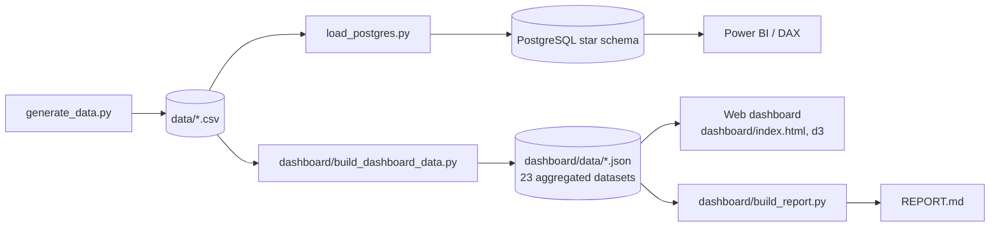

# Branch Sales, Installation & Service KPI Mart

**Project report.** Portfolio project built on a fully synthetic dataset. Every company, customer, employee and rupee value is generated, and nothing here describes a real business.

- **Dashboard:** [https://claude.ai/artifact/LzSYs78dp5rZF2QESL3WWb](https://claude.ai/artifact/LzSYs78dp5rZF2QESL3WWb) (six tabs, branch filter)
- **Data as of:** 12 October 2026 · **Year to date (YTD):** Jan–Sep 2026, compared with Jan–Sep 2025
- **Rebuild:** `python dashboard/build_dashboard_data.py && python dashboard/build_report.py`

---

## Contents

1. [Summary in numbers](#1-summary-in-numbers)
2. [The business question](#2-the-business-question)
3. [Data](#3-data)
4. [Architecture](#4-architecture)
5. [KPI definitions](#5-kpi-definitions)
6. [Dashboard tour](#6-dashboard-tour)
7. [Findings: branch scorecard](#7-findings-branch-scorecard)
8. [Findings: sales](#8-findings-sales)
9. [Findings: installation](#9-findings-installation)
10. [Findings: service](#10-findings-service)
11. [Findings: people and targets](#11-findings-people-and-targets)
12. [Recommendations](#12-recommendations)
13. [Data quality](#13-data-quality)
14. [Method and assumptions](#14-method-and-assumptions)
15. [Limitations](#15-limitations)
16. [How to reproduce](#16-how-to-reproduce)
17. [Skills demonstrated](#17-skills-demonstrated)

## 1. Summary in numbers

| Metric | Value | Context |
| :--- | ---: | :--- |
| Agreement value, Jan–Sep 2026 | ₹28.30 Cr | −2% vs Jan–Sep 2025 |
| Sales vs target | 75% | Target ₹37.68 Cr |
| Units installed vs target | 71% | 353 of 495 units |
| Installation backlog | 390 | 251 delayed, ₹6.06 Cr open vendor POs |
| Repair orders past SLA | 34% | 30% a year earlier |
| Open repair orders | 90 | 17 P1-Critical, 89 past SLA |
| Active AMC portfolio | ₹12.74 Cr | 1,414 contracts, 87% of post-warranty units covered |
| AMC renewals due in 90 days | 145 | ₹1.33 Cr annual value |

**The answer in five lines**

- Vapi is the branch furthest off target, and the gap starts with sales.
- Ahmedabad is the branch going backwards: agreement value is down 29% on last year.
- Pune leads on both sales (91% of target) and installation (97%).
- Service is a company-wide problem, not one branch's: 34% of 2026 repair orders missed SLA.
- Every branch misses somewhere: Surat on installation and service; Vadodara on sales, installation and service; Vapi on sales, installation and service; Ahmedabad on sales, installation and service; Pune on service.

## 2. The business question

Branch leadership at a vertical-transport (lift) company asks one question every month:

> *Which branch is off target, and is it a sales problem, an installation problem, or a service problem?*

The business runs in three hand-offs. **Sales** turns leads into signed agreements. **Installation** puts each unit in, using third-party vendors on purchase orders. **Service** covers the unit under warranty, sells an annual maintenance contract (AMC), and handles repair orders. A miss in one department shows up in the next, so the dashboard follows the same chain and keeps all five branches side by side: Surat, Vadodara, Vapi, Ahmedabad and Pune.

## 3. Data

A star schema of 6 dimensions and 11 fact tables, exported as CSV in `data/`. It is generated by `generate_data.py`.

| Table | Area | Grain | Rows | Date range |
| :--- | :--- | :--- | ---: | :--- |
| `dim_branch` | Branch | One branch | 5 | — |
| `dim_department` | Department | One department | 3 | — |
| `dim_employee` | Employee | One employee (role, branch, hire date) | 130 | Oct 2018 – Oct 2026 |
| `dim_customer` | Customer | One customer (type, city) | 2,146 | — |
| `dim_vendor` | Vendor | One installation vendor | 15 | — |
| `dim_calendar` | Calendar | One day | 1,461 | Jan 2023 – Dec 2026 |
| `fact_leads` | Sales | One lead | 4,500 | Oct 2023 – Oct 2026 |
| `fact_inquiries` | Sales | One inquiry | 2,919 | Oct 2023 – Oct 2026 |
| `fact_quotations` | Sales | One quotation | 2,157 | Oct 2023 – Oct 2026 |
| `fact_bookings` | Sales | One agreement (booking) | 890 | Nov 2023 – Oct 2026 |
| `fact_units` | Installation | One lift unit | 1,736 | Jan 2024 – Oct 2026 |
| `fact_installation_pos` | Installation | One vendor PO line | 4,941 | Nov 2023 – Oct 2026 |
| `fact_warranty` | Service | One unit's warranty | 1,139 | Jan 2024 – Oct 2026 |
| `fact_amc` | Service | One AMC contract | 1,600 | Jun 2024 – Oct 2026 |
| `fact_repair_orders` | Service | One repair order | 921 | Apr 2024 – Oct 2026 |
| `fact_incentives` | People | One monthly incentive payment | 2,263 | — |
| `fact_employee_targets` | People | One target per employee, metric and period | 6,630 | — |

Units carry an ID of the form `BK-YYYY-NNNNNL001`: the booking ID plus the unit's line number. That key links an agreement to its units, their vendor POs, warranty, AMC contracts and repair orders.

## 4. Architecture



- The **SQL path** (`sql/schema.sql`, `load_postgres.py`, `docs/dax_measures.md`) is the warehouse version for Power BI.
- The **dashboard path** aggregates with pandas into small JSON files, one per visual family. Each figure on the page is tagged with the dataset and field it came from.
- **Signals and findings are generated, not typed.** The build script writes the short signals on the dashboard and the sentences in this report from the same aggregates, so they stay correct after a data refresh.

## 5. KPI definitions

| KPI | Definition | Source |
| :--- | :--- | :--- |
| Agreement value | Total agreement value of **Confirmed** agreements, by signing date | `fact_bookings` |
| Sales target | Sum of Salesperson monthly targets (Sales Manager targets overlap and are not added) | `fact_employee_targets` |
| Sales vs target | Agreement value ÷ sales target, YTD | both |
| Lead → agreement | Confirmed agreements signed in the period ÷ leads created in the period | `fact_leads`, `fact_bookings` |
| Units installed | Units with status Completed, by completion date | `fact_units` |
| Installs vs target | Units installed ÷ sum of Installation Engineer *Units completed* targets | `fact_units`, targets |
| Installation backlog | Confirmed-agreement units that are Scheduled, In Progress or Delayed | `fact_units` |
| Parked units | Units on Cancelled or On Hold agreements (shown as Pending in the source) | `fact_units`, `fact_bookings` |
| Open vendor POs | PO lines with status Open | `fact_installation_pos` |
| Repairs past SLA | Share of repair orders opened in the period with `exceeded_sla = true` | `fact_repair_orders` |
| Open repair orders | Status Open or In Progress at the as-of date | `fact_repair_orders` |
| Active AMC value | Annual value of contracts with status Active | `fact_amc` |
| AMC renewals due | Active contracts whose end date falls in the next 90 days | `fact_amc` |
| Post-warranty AMC cover | Units out of warranty that have an Active AMC ÷ units out of warranty | `fact_warranty`, `fact_amc` |
| Lapsed AMC | Expired contract with no later contract on the same unit | `fact_amc` |
| Out-of-scale target | A role whose company-wide attainment is below 50% or above 200% | targets + actuals |

**Status thresholds used for colour:** sales 🟢 ≥ 85% of target, 🟡 ≥ 70%, otherwise 🔴. Installation 🟢 ≥ 85%, 🟡 ≥ 60%. Repairs past SLA 🟢 ≤ 25%, 🟡 ≤ 32%.

## 6. Dashboard tour

Each tab follows the same pattern: **KPI tiles** with a 12-month micro-chart or a target meter, a strip of **four number signals**, then the **charts**. A branch picker in the header, or a click on any branch, filters every tab.

| Tab | Tiles | Charts |
| :--- | :--- | :--- |
| Overview | Agreement value, sales vs target, units installed, backlog, repairs past SLA, AMC renewals due | Branch scorecard heatmap · sales vs installs dumbbell · value by branch vs last year · monthly value vs target |
| Sales | Agreement value, vs target, agreements, leads, conversion | Monthly value vs target · funnel vs last year · signed value by outcome (donut) · leads and conversion by branch · conversion by source · every salesperson vs target |
| Installation | Units installed, vs target, backlog, delayed, open POs | Units booked vs installed · unit status (donut) · installs vs target by branch · PO cost by line item · spend by vendor |
| Service | Repair orders, past SLA, open past SLA, AMC value, renewals due, post-warranty cover | Repair orders and breaches by quarter · breach by priority · open ROs by age · renewals and warranty expiries ahead · AMC by branch · repair cost by cover (donut) · faults · technician scatter |
| People | Headcount, incentives, salespeople at target, roles out of scale | Attainment by role · incentives by year and role · role × branch attainment heatmap |
| Data quality | One card per issue | Rows and money affected |

## 7. Findings: branch scorecard

Jan–Sep 2026. 🟢 on target · 🟡 watch · 🔴 off target.

| Branch | Agreement value | Sales vs target | vs last year | Installs vs target | Units delayed | Past SLA | Open ROs | AMC due 90 d | Off target in |
| :--- | ---: | ---: | ---: | ---: | ---: | ---: | ---: | ---: | :--- |
| **Surat** | ₹7.32 Cr | 🟢 88% | +23% | 🟡 82% | 64 | 🔴 38% | 25 | 23 | installation, service |
| **Vadodara** | ₹5.47 Cr | 🔴 68% | −3% | 🔴 53% | 37 | 🔴 34% | 18 | 25 | sales, installation, service |
| **Vapi** | ₹2.95 Cr | 🔴 52% | −14% | 🔴 46% | 35 | 🟡 29% | 12 | 25 | sales, installation, service |
| **Ahmedabad** | ₹6.10 Cr | 🟡 72% | −29% | 🟡 77% | 67 | 🔴 34% | 21 | 42 | sales, installation, service |
| **Pune** | ₹6.46 Cr | 🟢 91% | +21% | 🟢 97% | 48 | 🟡 30% | 14 | 30 | service |
| Company | ₹28.30 Cr | 🟡 75% | −2% | 🟡 71% | 251 | 🔴 34% | 90 | 145 | sales, installation, service |

- **Vapi is the branch furthest off target, and the gap starts with sales.** Vapi booked ₹2.95 Cr in Jan–Sep 2026, 52% of its ₹5.68 Cr target, against 75% company-wide. It is also last on installation (46% of target) and has the fewest leads of any branch.
- **Ahmedabad is the branch going backwards: agreement value is down 29% on last year.** Ahmedabad booked ₹6.10 Cr in Jan–Sep 2026 against ₹8.55 Cr a year earlier, and it has the most AMC renewals due in the next 90 days (42).
- **Pune leads on both sales (91% of target) and installation (97%).** Company-wide, Jan–Sep 2026 agreement value is ₹28.30 Cr, down 2% on the same months of 2025, and 75% of the ₹37.68 Cr target.
- **Service is a company-wide problem, not one branch's: 34% of 2026 repair orders missed SLA.** Every branch breaches on more than one job in four (Surat worst at 38%, Vapi best at 29%). 90 repair orders are still open, 89 of them past SLA and 17 of them P1-Critical.
- **Every branch misses somewhere: Surat on installation and service; Vadodara on sales, installation and service; Vapi on sales, installation and service; Ahmedabad on sales, installation and service; Pune on service.** A branch is off target on sales below 85% of target, on installation below 85%, and on service above 25% of repair orders past SLA. Vadodara, Vapi and Ahmedabad miss on all three, so their gap is not one department's problem.

## 8. Findings: sales

- **Vapi's shortfall is lead volume, not conversion.** Vapi generated 118 leads in Jan–Sep 2026, 55% of the branch average, yet converts 18.6% of leads into agreements, close to the company's 18.5%. More leads, not better closing, is the fix.
- **Pune converts best because it wins more of its quotations.** Lead-to-agreement conversion runs from 16.6% (Vadodara) to 21.8% (Pune). 40% of Pune's quotations become agreements, against 31% at Vadodara and Vapi.
- **Cancelled and on-hold agreements hold ₹15.60 Cr of value.** That is 12% of everything signed since 2023. On-hold deals (₹7.03 Cr) are the recoverable part and worth a monthly review.
- **Architect referrals convert best (18.7%); cold calls convert worst (16.3%).** The spread across sources is narrow. Source mix is not what separates strong and weak branches.
- **Monthly bookings dipped from April to July 2026.** April 2026 was the weakest of the last 24 complete months at ₹1.63 Cr. August and September recovered to ₹4.07 Cr and ₹4.82 Cr.

**Funnel, company, Jan–Sep 2026 vs Jan–Sep 2025**

| Stage | This year | Last year | Kept from step before | Share of leads |
| :--- | ---: | ---: | ---: | ---: |
| Leads | 1,068 | 1,178 | — | 100.0% |
| Inquiries | 695 | 772 | 65% | 65.1% |
| Quotations | 554 | 553 | 80% | 51.9% |
| Agreements won | 198 | 204 | 36% | 18.5% |

**Leads and conversion by branch, Jan–Sep 2026**

| Branch | Leads | Leads last year | Agreements | Lead → agreement | Quotation → agreement |
| :--- | ---: | ---: | ---: | ---: | ---: |
| Surat | 296 | 300 | 52 | 17.6% | 38% |
| Vadodara | 217 | 244 | 36 | 16.6% | 31% |
| Vapi | 118 | 151 | 22 | 18.6% | 31% |
| Ahmedabad | 249 | 264 | 47 | 18.9% | 37% |
| Pune | 188 | 219 | 41 | 21.8% | 40% |

**Signed value by outcome, all history**

| Status | Agreements | Units | Value | Share of value |
| :--- | ---: | ---: | ---: | ---: |
| Confirmed | 776 | 1,529 | ₹111.62 Cr | 87.7% |
| On Hold | 53 | 92 | ₹7.03 Cr | 5.5% |
| Cancelled | 61 | 115 | ₹8.57 Cr | 6.7% |

**Lead sources, all history**

| Source | Leads | Agreements | Conversion | Average deal |
| :--- | ---: | ---: | ---: | ---: |
| Architect | 781 | 146 | 18.7% | ₹14.2 L |
| Website | 769 | 132 | 17.2% | ₹14.5 L |
| Exhibition | 758 | 130 | 17.2% | ₹15.0 L |
| Existing Customer | 704 | 120 | 17.0% | ₹13.6 L |
| Referral | 775 | 132 | 17.0% | ₹14.4 L |
| Cold Call | 713 | 116 | 16.3% | ₹14.6 L |

**Salespeople, Jan–Sep 2026: top five and bottom five by attainment**

| Salesperson | Branch | Agreement value | Target | Attainment | Quote win rate |
| :--- | :--- | ---: | ---: | ---: | ---: |
| Nitara Bakshi | Ahmedabad | ₹2.34 Cr | ₹1.77 Cr | 132% | 58% |
| Abdul Chhabra | Pune | ₹1.68 Cr | ₹1.36 Cr | 124% | 56% |
| Hemangini Lalla | Surat | ₹1.70 Cr | ₹1.40 Cr | 121% | 47% |
| Ryan Sharma | Ahmedabad | ₹1.68 Cr | ₹1.55 Cr | 108% | 53% |
| Jairaj Shan | Pune | ₹1.67 Cr | ₹1.56 Cr | 107% | 55% |
| Patrick Vasa | Pune | ₹74.2 L | ₹1.60 Cr | 46% | 32% |
| Mohammed Gupta | Vapi | ₹52.9 L | ₹1.22 Cr | 43% | 25% |
| Darsh Murthy | Vapi | ₹32.7 L | ₹1.04 Cr | 32% | 27% |
| Netra Dar | Vapi | ₹29.6 L | ₹1.12 Cr | 26% | 24% |
| Nisha Kothari | Ahmedabad | ₹12.9 L | ₹1.97 Cr | 7% | 17% |

## 9. Findings: installation

- **Completions slowed in the second half while bookings held up, so the backlog is growing.** Units completed fell from 44 a month in January–June to 29 a month in July–September, while new agreements added 45 units a month. 390 units on confirmed agreements are waiting or in work.
- **251 units are Delayed, and they tie up ₹6.06 Cr of open vendor POs.** Delayed jobs take 57 days from start to finish against 40 for on-time jobs. Every open PO sits on a delayed or in-progress unit, so clearing delays also releases vendor cost.
- **207 'Pending' units belong to cancelled or on-hold agreements.** They are not installation backlog. The dashboard shows them as parked so they do not inflate the backlog figure.
- **Vapi's installation gap is mostly its sales gap carried forward.** Vapi completed 37 units against a target of 81, with as many engineers as larger branches. Fewer agreements means fewer units to install. Its delayed share is 18%, the highest of any branch.
- **Third-party cost is spread evenly: 15 vendors each take 6%–7% of PO value.** No single vendor is a concentration risk. Total PO value to date is ₹27.92 Cr, about ₹1.9 L per unit across four line items.

**Where every unit stands, now**

| Status | Units | Share |
| :--- | ---: | ---: |
| Completed | 1,139 | 65.6% |
| In Progress | 60 | 3.5% |
| Scheduled | 79 | 4.6% |
| Delayed | 251 | 14.5% |
| Parked (On Hold agreement) | 92 | 5.3% |
| Parked (Cancelled agreement) | 115 | 6.6% |

**Units booked vs installed, last six complete months**

| Month | Units booked | Units installed | Gap |
| :--- | ---: | ---: | ---: |
| Apr 2026 | 25 | 48 | -23 |
| May 2026 | 46 | 40 | +6 |
| Jun 2026 | 43 | 41 | +2 |
| Jul 2026 | 28 | 23 | +5 |
| Aug 2026 | 59 | 29 | +30 |
| Sep 2026 | 47 | 35 | +12 |

**Vendor PO cost by line item, all history**

| Line item | PO lines | Value | Still open |
| :--- | ---: | ---: | ---: |
| Scaffolding Charges | 1,256 | ₹8.64 Cr | ₹1.91 Cr |
| Erection & Installation Charges | 1,213 | ₹8.24 Cr | ₹1.77 Cr |
| Wiring Charges | 1,235 | ₹8.23 Cr | ₹1.79 Cr |
| Misc Project Cost | 1,237 | ₹2.80 Cr | ₹0.59 Cr |

Fifteen vendors share the PO value. The largest takes 7.1% and the smallest 6.2%.

## 10. Findings: service

- **SLA breaches rose to 34% in Q3 2026, from 24% in Q4 2025.** Repair volume is up as the installed base grows (118 ROs in Q3 2025, 129 in Q3 2026) without a matching gain in on-time closure. P1-Critical jobs breach as often as normal ones.
- **90 repair orders are still open, most of them for months.** The median open RO is 246 days old and 17 are P1-Critical. Either the work is done and not closed in the system, or customers are waiting; both need a ticket-by-ticket review.
- **145 AMC contracts worth ₹1.33 Cr a year come up for renewal in the next 90 days.** Ahmedabad has the most (42). Of contracts that have already expired, 25% were not followed by a new contract on the same unit.
- **AMC capture after warranty is strong: 87% of out-of-warranty units have an active AMC.** The active portfolio is 1,414 contracts worth ₹12.74 Cr a year, split almost evenly between comprehensive and non-comprehensive. 78 more units leave warranty in the next 90 days.
- **Warranty jobs carry 82% of repair cost.** 738 of 921 repair orders were on units under warranty, so the company absorbs most parts and labour cost. Cable wear is the most common fault (140 ROs). 248 units have needed two or more repairs.

**Repair orders by quarter (company)**

| Quarter | Repair orders | Breached SLA | Breach rate | Median resolution |
| :--- | ---: | ---: | ---: | ---: |
| Q2 2024 | 14 | 2 | 14% | 7 h |
| Q3 2024 | 32 | 8 | 25% | 9 h |
| Q4 2024 | 73 | 22 | 30% | 10 h |
| Q1 2025 | 71 | 26 | 37% | 8 h |
| Q2 2025 | 88 | 24 | 27% | 10 h |
| Q3 2025 | 118 | 33 | 28% | 9 h |
| Q4 2025 | 121 | 29 | 24% | 9 h |
| Q1 2026 | 127 | 46 | 36% | 10 h |
| Q2 2026 | 132 | 42 | 32% | 10 h |
| Q3 2026 | 129 | 44 | 34% | 12 h |
| Q4 2026 (partial) | 16 | 12 | 75% | 13 h |

**By priority, all history**

| Priority | SLA | Repair orders | Breach rate | Median resolution | Open now |
| :--- | ---: | ---: | ---: | ---: | ---: |
| P1-Critical | 4 h | 127 | 32% | 2 h | 17 |
| P2-High | 8 h | 312 | 33% | 5 h | 32 |
| P3-Normal | 24 h | 482 | 30% | 16 h | 41 |

**Open repair orders by age (90 total)**

| Age | Open ROs |
| :--- | ---: |
| 0–30 days | 16 |
| 31–90 days | 5 |
| 91–180 days | 16 |
| 181–365 days | 21 |
| Over a year | 32 |

**Who carries repair cost, all history**

| Cover when opened | Repair orders | Parts | Labour | Share of cost |
| :--- | ---: | ---: | ---: | ---: |
| Warranty only | 607 | ₹139.2 L | ₹51.5 L | 68.5% |
| Warranty + AMC | 131 | ₹24.9 L | ₹11.4 L | 13.0% |
| AMC only (post-warranty) | 103 | ₹17.4 L | ₹8.5 L | 9.3% |
| No cover | 80 | ₹17.8 L | ₹7.5 L | 9.1% |

**Most common faults**

| Fault | Repair orders | Breach rate | Average cost |
| :--- | ---: | ---: | ---: |
| Cable wear | 140 | 36% | ₹0.3 L |
| Button panel issue | 123 | 29% | ₹0.3 L |
| Safety gear check | 117 | 29% | ₹0.3 L |
| Controller error | 113 | 30% | ₹0.3 L |
| Door sensor fault | 112 | 34% | ₹0.3 L |
| Vibration | 112 | 29% | ₹0.3 L |
| Oil leak | 103 | 28% | ₹0.3 L |
| Motor overheating | 101 | 34% | ₹0.3 L |

**AMC renewals and warranty expiries, next six months**

| Month | AMC renewals | Comprehensive | Non-comprehensive | Annual value | Warranties expiring |
| :--- | ---: | ---: | ---: | ---: | ---: |
| Oct 2026 | 21 | 8 | 13 | ₹16.5 L | 27 |
| Nov 2026 | 47 | 25 | 22 | ₹46.5 L | 30 |
| Dec 2026 | 56 | 22 | 34 | ₹50.0 L | 21 |
| Jan 2027 | 50 | 23 | 27 | ₹42.8 L | 36 |
| Feb 2027 | 55 | 33 | 22 | ₹51.9 L | 43 |
| Mar 2027 | 50 | 27 | 23 | ₹37.6 L | 36 |

**Active AMC portfolio by branch**

| Branch | Comprehensive | Non-comprehensive | Annual value | Expired AMCs lapsed |
| :--- | ---: | ---: | ---: | ---: |
| Surat | 176 | 145 | ₹2.85 Cr | 32% |
| Vadodara | 118 | 150 | ₹2.38 Cr | 21% |
| Vapi | 75 | 104 | ₹1.65 Cr | 24% |
| Ahmedabad | 186 | 181 | ₹3.36 Cr | 23% |
| Pune | 136 | 143 | ₹2.49 Cr | 26% |

**Technicians with the highest breach rate**

| Technician | Branch | Repair orders | Breach rate | Median resolution |
| :--- | :--- | ---: | ---: | ---: |
| George Sampath | Vapi | 17 | 59% | 11 h |
| Yashasvi Suresh | Vapi | 10 | 50% | 9.5 h |
| Neha Merchant | Ahmedabad | 30 | 47% | 11.5 h |
| Logan Sami | Vadodara | 25 | 40% | 9 h |
| Thomas Sura | Pune | 30 | 40% | 11.5 h |

## 11. Findings: people and targets

- **Targets for 4 of 8 roles are out of scale with the business.** Company-wide attainment: Lead Generator 32%; Service Sales Person 911%; Service Supervisor 44%; Service Technician 13%. Attainment this far from 100% says the target was not built from the volume these teams handle. Reset them before tying incentives to them.
- **6 of 25 salespeople are at or above their Jan–Sep 2026 target.** Individual attainment runs from 7% to 132%. The bottom five are a coaching list; the top five show what the plan allows.
- **Incentives paid in Jan–Sep 2026 totalled ₹32.4 L, spread across all eight roles.** Salespeople take the largest share. Payouts follow headcount more than results: branch totals ranged only from ₹5.8 L (Vapi) to ₹6.8 L (Ahmedabad), although sales attainment ranged from 52% to 91%.
- **346 incentive payments (₹20.0 L) are dated before the employee was hired.** Listed with the other data issues below. Fix the source before using incentive history for pay decisions.

**Target attainment, Jan–Sep 2026** (✱ = target out of scale with volume)

| Role | Measured on | Surat | Vadodara | Vapi | Ahmedabad | Pune | Company |
| :--- | :--- | ---: | ---: | ---: | ---: | ---: | ---: |
| Lead Generator ✱ | Leads | 41% | 33% | 21% | 33% | 31% | 32% |
| Salesperson | Agreement value | 88% | 68% | 52% | 72% | 91% | 75% |
| Sales Manager | Agreement value | 110% | 92% | 51% | 72% | 112% | 87% |
| Installation Engineer | Units completed | 82% | 53% | 46% | 77% | 97% | 71% |
| Installation Manager | Units completed | 114% | 66% | 54% | 79% | 112% | 85% |
| Service Sales Person ✱ | AMC value | 899% | 833% | 826% | 935% | 1044% | 911% |
| Service Supervisor ✱ | Repair orders closed | 51% | 47% | 30% | 53% | 37% | 44% |
| Service Technician ✱ | Repair orders closed | 15% | 15% | 8% | 15% | 12% | 13% |

**Incentives paid by year (company)**

| Year | Amount | Payments |
| :--- | ---: | ---: |
| 2024 | ₹42.8 L | 790 |
| 2025 | ₹44.7 L | 804 |
| 2026 (to Oct) | ₹36.0 L | 669 |

## 12. Recommendations

| # | Action | Owner | Why (from the data) | Track |
| ---: | :--- | :--- | :--- | :--- |
| 1 | Rebuild the lead engine in the weakest branch: field lead generators, architect and referral programmes | Sales | Vapi's shortfall is lead volume, not conversion. | Leads per month, lead → agreement |
| 2 | Run a quotation win-loss review in branches below the company quote-to-agreement rate | Sales | Lead-to-agreement conversion runs from 16.6% (Vadodara) to 21.8% (Pune). 40% of Pune's quotations become agreements, against 31% at Vadodara and Vapi. | Quotation → agreement |
| 3 | Monthly review of on-hold agreements | Sales | Cancelled and on-hold agreements hold ₹15.60 Cr of value. | On-hold value, revived deals |
| 4 | Clear delayed installations: vendor-by-vendor recovery plan, close open POs | Installation | 251 units are Delayed, and they tie up ₹6.06 Cr of open vendor POs. | Delayed units, open PO value |
| 5 | Restore installation throughput to the booking rate | Installation | Units completed fell from 44 a month in January–June to 29 a month in July–September, while new agreements added 45 units a month. | Units installed vs booked per month |
| 6 | Ticket-by-ticket review of open repair orders; close or escalate everything older than 30 days | Service | 90 repair orders are still open, most of them for months. | Open ROs by age |
| 7 | Dispatch rule that puts P1-Critical first, plus technician coaching on the highest breach rates | Service | SLA breaches rose to 34% in Q3 2026, from 24% in Q4 2025. | Breach rate by priority |
| 8 | Renewal desk for the next 90 days of AMC expiries | Service | 145 AMC contracts worth ₹1.33 Cr a year come up for renewal in the next 90 days. | Renewal rate, lapsed units |
| 9 | Root-cause the top warranty faults with engineering and vendors | Service / Installation | Warranty jobs carry 82% of repair cost. | Warranty repair cost, repeat ROs |
| 10 | Rebase targets from actual volume before tying incentives to them | Leadership / HR | Targets for 4 of 8 roles are out of scale with the business. | Share of roles in scale |
| 11 | Fix the data issues below at source | Data / ERP | 6 issues found | Issue counts to zero |

## 13. Data quality

Issues found while building the mart. Each one changes how a number should be read, and the dashboard handles them as described.

| Issue | Table | Rows | Money affected | What it means |
| :--- | :--- | ---: | ---: | :--- |
| Incentives paid before the employee's hire month | `fact_incentives` | 346 | ₹20.0 L | 36 employees. Incentive totals by person overstate their tenure. |
| AMC contracts that overlap the next contract on the same unit | `fact_amc` | 533 | ₹4.61 Cr | 339 units carry more than one Active contract, which inflates active AMC value. |
| Open repair orders older than 30 days | `fact_repair_orders` | 74 | ₹24.4 L | Likely closed in the field but not in the system. Open-RO and SLA counts include them. |
| Units on cancelled or on-hold agreements shown as Pending | `fact_units` | 207 | ₹12.65 Cr | Every Pending unit belongs to a cancelled or on-hold agreement. This dashboard parks them outside the backlog. |
| Repair orders flagged as under warranty | `fact_repair_orders` | 738 | ₹2.27 Cr | The metric dictionary scopes ROs to non-comprehensive AMC and uncovered units, yet most are warranty jobs. Confirm the flag's meaning. |
| Incentives on the 'New AMC' basis paid to non-service roles | `fact_incentives` | 425 | ₹22.8 L | Basis labels look assigned at random across roles; basis-level analysis is not reliable. |

## 14. Method and assumptions

- **As-of date** is the latest lead, booking or repair-order date in the extract: 12 Oct 2026.
- **YTD** runs from 1 January to the last complete month (Jan–Sep 2026) and is compared with the same months of the prior year. The latest month is shown as partial in monthly charts.
- **Attribution.** Agreements go to their salesperson and sales manager, leads to their lead generator, completed units to their installation engineer, AMC value to its service salesperson, and closed repair orders to their supervisor and technician. Installation managers are credited with their branch's completed units, because units carry no manager ID.
- **Branch totals** come from the fact table's own `branch_id`. Every employee's attributed activity sits in their home branch.
- **Each branch dataset carries an *All* row**, so the dashboard's branch filter only selects rows and never recomputes totals in the browser.
- **Renewal and lapse.** Because contracts on the same unit overlap (see Data quality), a contract counts as renewed when any later contract exists on the same unit.

## 15. Limitations

- The dataset is synthetic: distributions are generated, and many rates are close to uniform. Use the findings to show method, not to make claims about any real company.
- Targets for several roles do not match the generated volumes. Their attainment is reported but flagged rather than judged.
- No cost of sales or margin data beyond equipment cost, so profitability is out of scope.
- Repair-order SLA is a flag in the source. Resolution hours are not recomputed from timestamps.

## 16. How to reproduce

```bash
pip install pandas numpy
python generate_data.py                      # optional: regenerate data/*.csv
python dashboard/build_dashboard_data.py     # data/*.csv -> dashboard/data/*.json
python dashboard/build_report.py             # dashboard/data/*.json -> REPORT.md
```

For the warehouse path, run `sql/schema.sql` and then `python load_postgres.py --db yourdb`, and connect Power BI with the measures in `docs/dax_measures.md`. The checks in `sql/reconciliation.sql` should match the dashboard totals.

## 17. Skills demonstrated

- **Data modelling:** star schema across three departments, a unit-level key that links sales, installation and service.
- **KPI design:** definitions agreed in business language, a target framework, status thresholds and a north-star metric per department.
- **Analytics engineering:** a reproducible pandas pipeline, pre-aggregated datasets, and a report generated from code.
- **Root-cause analysis:** separating volume from conversion problems, and backlog from parked units.
- **Data quality:** six issues found and quantified, with the dashboard designed around each.
- **Visualisation:** a multi-tab d3 dashboard with KPI tiles, micro-charts, heatmaps, a funnel, donuts, a dumbbell and a scatter, plus a branch filter and tooltips.
- **Communication:** findings and recommendations tied to a metric to track.

